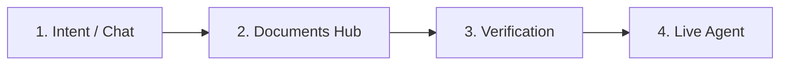
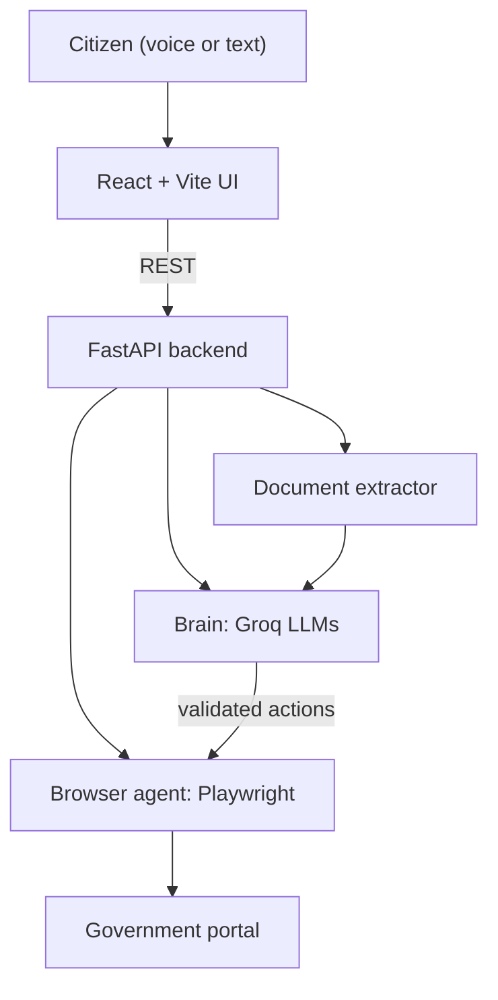

# SahayakAI

An autonomous AI agent that helps Indian citizens reach government schemes. The citizen speaks or types in Hindi, English or Hinglish, and the agent explains the scheme, collects the right documents, fills the portal form and submits it after the citizen confirms.

Built for the FORGE '26 Hackathon.

---

## Table of Contents

1. [Problem and Solution](#1-problem-and-solution)
2. [Key Features](#2-key-features)
3. [How It Works](#3-how-it-works)
4. [Tech Stack](#4-tech-stack)
5. [Project Structure](#5-project-structure)
6. [Getting Started](#6-getting-started)
7. [Environment Variables](#7-environment-variables)
8. [Running the Tests](#8-running-the-tests)
9. [API Overview](#9-api-overview)
10. [Privacy and Safety](#10-privacy-and-safety)
11. [Known Limitations](#11-known-limitations)
12. [Future Scope](#12-future-scope)
13. [Team](#13-team)
14. [License](#14-license)

---

## 1. Problem and Solution

### The problem

- Citizens deal with many fragmented central and state portals (ServicePlus, National Scholarship Portal, Vidya Lakshmi, PM-KISAN, DigiLocker and others), each with a different layout, field names and rules.
- Many `.gov.in` portals rely on older server-rendered designs with session timeouts, rigid validation, cascading dropdowns and strict document constraints.
- Language barriers, unclear document requirements, upload size limits, scanned or messy certificates and CAPTCHAs push many citizens towards paid middlemen.

### The solution

SahayakAI handles the full journey:

1. Understands the citizen's request in Hindi, English or Hinglish, by voice or text.
2. Explains the matching scheme, including eligibility and required documents.
3. Collects documents from local uploads or the citizen's Google account (after consent) and extracts the profile details.
4. Lets the citizen verify and correct every detail.
5. Drives the live portal form and pauses for the citizen at CAPTCHA and declaration checkpoints.

---

## 2. Key Features

- **Multilingual chat and voice:** Hindi, English and Hinglish input, with speech recognition and text-to-speech.
- **Four interaction types:** general chat, scheme information, portal justification, and routing to apply.
- **Intent classification with fallback:** a keyword matcher runs first, and an LLM handles conversational or regional queries. A heuristic scorer keeps the system working if the LLM is unavailable.
- **Smart document extraction:** regex and PDF text extraction first, with LLM text and vision fallbacks for scanned or skewed documents.
- **Aadhaar precedence for date of birth:** identity fields from Aadhaar override conflicting dates on secondary documents such as marksheets.
- **Document discovery:** Google Vault search for matching files (Drive, Gmail and attachments) and a compressor that fits files to portal size limits.
- **Zero-shot DOM distillation:** reads an unmapped portal form and compresses it into a compact JSON description of its fields, so selectors do not have to be hardcoded.
- **Deterministic fast path:** mapped portals run from fixed configuration with no LLM call.
- **Deterministic eligibility engine:** age, income ceiling, state domicile and required-field checks, with a readable explanation for each rule.
- **Human in the loop:** the citizen enters CAPTCHA (with audio playback for accessibility), OTP and the final declaration.
- **No invented data:** details that are not found in the citizen's documents are left for the citizen to fill.
- **Honest failure handling:** if a portal is unreachable, the app shows a diagnostic screen with retry options instead of silently using a mock.

---

## 3. How It Works

The app guides the citizen through four steps.



**Step 1: Intent and chat.** The classifier (`/api/intent/classify`) identifies the scheme, the official portal, whether login is required, the ordered workflow steps and suggested documents. Responses are checked against known portal URLs to avoid invented domains.

**Step 2: Documents hub.** The citizen uploads PDFs or images, or searches Google Vault. Services that need no documents, such as DigiLocker sign-up, skip this step. When a scheme requires proof, the citizen cannot continue until documents are attached.

**Step 3: Verification.** The citizen reviews and edits the extracted profile. Fields the extractor was unsure about are highlighted. The eligibility engine returns a pass or fail result per rule, and the citizen must confirm that the data is accurate before the agent starts.

**Step 4: Live agent.** A split-screen view shows the agent terminal on one side and the live portal on the other. The portal lifecycle has three stages:

1. **Sign-in:** existing account sign-in, or one-click auto-registration using the verified profile.
2. **Form:** the agent fills the form and attaches documents.
3. **Submission checkpoint:** the citizen solves the CAPTCHA, accepts the declaration and approves submission, and an acknowledgement receipt is shown.

### Architecture



The system follows a "Brain vs. Hands" design. **The LLM never touches the browser directly.** It outputs structured actions (`fill`, `select`, `upload`, `check`), and the browser agent validates and executes them.

---

## 4. Tech Stack

| Layer | Technology |
| :--- | :--- |
| Frontend | React 18, TypeScript, Vite, Web Speech API (recognition and synthesis) |
| Backend | Python 3.11+, FastAPI, Uvicorn, Pydantic v2 |
| LLM provider | Groq Cloud |
| Text models | `openai/gpt-oss-20b` (primary), `openai/gpt-oss-120b` (fallback) |
| Vision model | `qwen/qwen3.8-27b` for scanned-document extraction |
| Browser automation | Playwright (Chromium) |
| Document discovery | Google Drive and Google Vault integration |
| Testing | pytest |

---

## 5. Project Structure

```
project_forge_26/
├── backend/
│   ├── app/
│   │   ├── ai_form_agent.py    # DOM distillation and dynamic action plans
│   │   ├── browser_agent.py    # Playwright engine and session store
│   │   ├── eligibility.py      # Intent routing, scheme advice, eligibility rules
│   │   ├── extractor.py        # Document extraction and field precedence
│   │   ├── google_vault.py     # Google Vault document search and fetch
│   │   ├── llm_client.py       # Groq wrapper with fallback models
│   │   ├── main.py             # FastAPI app and endpoints
│   │   ├── portal_maps.py      # Deterministic portal configurations
│   │   └── schemas.py          # Pydantic models
│   ├── static/                 # Offline sandbox portal templates
│   └── requirements.txt
├── frontend/
│   ├── src/
│   │   ├── App.tsx             # 4-step pipeline and live agent view
│   │   ├── App.css
│   │   ├── api.ts              # Backend API client
│   │   └── types.ts
│   ├── package.json
│   └── vite.config.ts
├── tests/
│   ├── test_intent_llm.py
│   ├── test_extractor_llm.py
│   ├── test_ai_form_agent.py
│   └── test_full_pipeline.py
└── README.md
```

---

## 6. Getting Started

### Prerequisites

- Python 3.11 or newer
- Node.js 18 or newer, with npm
- A Groq API key from [console.groq.com](https://console.groq.com)

### Clone

```bash
git clone https://github.com/arijeetmukherjee3108-droid/project_forge_26.git
cd project_forge_26
```

### Backend

```bash
cd backend
python3 -m venv .venv
source .venv/bin/activate        # Windows: .\.venv\Scripts\activate
pip install -r requirements.txt
playwright install chromium
```

Create `backend/.env` (see [Environment Variables](#7-environment-variables)), then start the server:

```bash
uvicorn app.main:app --host 127.0.0.1 --port 8000 --reload
```

Interactive API docs are available at `http://127.0.0.1:8000/docs`.

### Frontend

In a second terminal:

```bash
cd frontend
npm install
npm run dev -- --host 127.0.0.1 --port 5173
```

Open `http://127.0.0.1:5173/`. Keep the backend running while you use the app.

---

## 7. Environment Variables

Create `backend/.env`. Use placeholder values below and never commit this file or any real key.

| Variable | Purpose | Example |
| :--- | :--- | :--- |
| `GROQ_API_KEY` | Groq Cloud API key | `your_groq_api_key_here` |
| `GROQ_MODEL` | Primary text model | `openai/gpt-oss-20b` |
| `GROQ_FALLBACK_MODEL` | Text model used if the primary fails | `openai/gpt-oss-120b` |
| `GROQ_VISION_MODEL` | Vision model for scanned documents | `qwen/qwen3.8-27b` |
| `GROQ_VISION_FALLBACK_MODEL` | Vision model used if the primary fails | `your_fallback_vision_model` |
| `BROWSER_HEADLESS` | Run Chromium without a window (`true` or `false`) | `false` |

If `GROQ_API_KEY` is missing, the app logs a warning and falls back to rule-based logic instead of crashing.

---

## 8. Running the Tests

From the project root, with the virtual environment active:

```bash
python3 -m pytest tests/test_intent_llm.py tests/test_extractor_llm.py tests/test_ai_form_agent.py -v
python3 tests/test_full_pipeline.py
```

The LLM tests use mocks, so no API key is needed for them. To check that the frontend builds:

```bash
cd frontend
npm run build
```

---

## 9. API Overview

| Method | Endpoint | Purpose |
| :--- | :--- | :--- |
| POST | `/api/intent/classify` | Classify the citizen's request and return the scheme, portal, workflow steps and advice |
| POST | `/api/documents/extract` | Extract a citizen profile from an uploaded file (multipart) |
| POST | `/api/eligibility` | Run the deterministic eligibility rules for a profile and service |
| POST | `/api/vault/search` | Search Google Vault by keywords |
| POST | `/api/vault/fetch` | Download a matched file and return its extraction |
| POST | `/api/agent/start` | Start the browser agent for a profile and service |
| POST | `/api/agent/resume` | Resume after CAPTCHA entry and submission approval |

Example request:

```bash
curl -s -X POST http://localhost:8000/api/intent/classify \
  -H "Content-Type: application/json" \
  -d '{"text": "I want a scholarship for college"}'
```

Full request and response schemas are in the Swagger docs at `/docs`.

---

## 10. Privacy and Safety

- **Consent first:** Google Drive, Gmail and Vault are searched only after the citizen grants access.
- **Minimal identifiers:** only the last four digits of the Aadhaar number are stored or logged.
- **No invented data:** the agent never guesses a missing detail, so the citizen completes it manually.
- **Citizen confirmation:** the citizen verifies the profile before the agent starts and approves the final submission.
- **Citizen-entered secrets:** CAPTCHA and OTP are entered by the citizen.
- **Secrets stay local:** `.env` files and API keys must never be committed.

---

## 11. Known Limitations

- Real government portals may use OTPs, CAPTCHAs or bot detection, so fully automated runs are only demonstrated on the ServicePlus flow. Other portals can need extra citizen steps.
- Portal field mappings are deterministic only for portals listed in `portal_maps.py`. Unmapped portals depend on the DOM reader and the LLM action plan, which are validated but less predictable.
- Extraction quality depends on document quality, and low-confidence fields are flagged for the citizen to review.

---

## 12. Future Scope

- Support for any portal in India through the AI DOM reader and validated action plans
- Smarter document discovery across Drive and Gmail
- Voice-first input in more regional languages
- Many more central and state schemes
- Application status tracking and reminders
- Assisted deployment at common service centres

---

## 13. Team

| Name | Role |
| :--- | :--- |
| Krrish Dixit | Browser agent and automation |
| Priya Verma | Backend API, extraction and intelligence layer |
| Arijeet Mukherjee | Frontend and user experience |

---

## 14. License

TODO: add a license (for example MIT) and a `LICENSE` file.